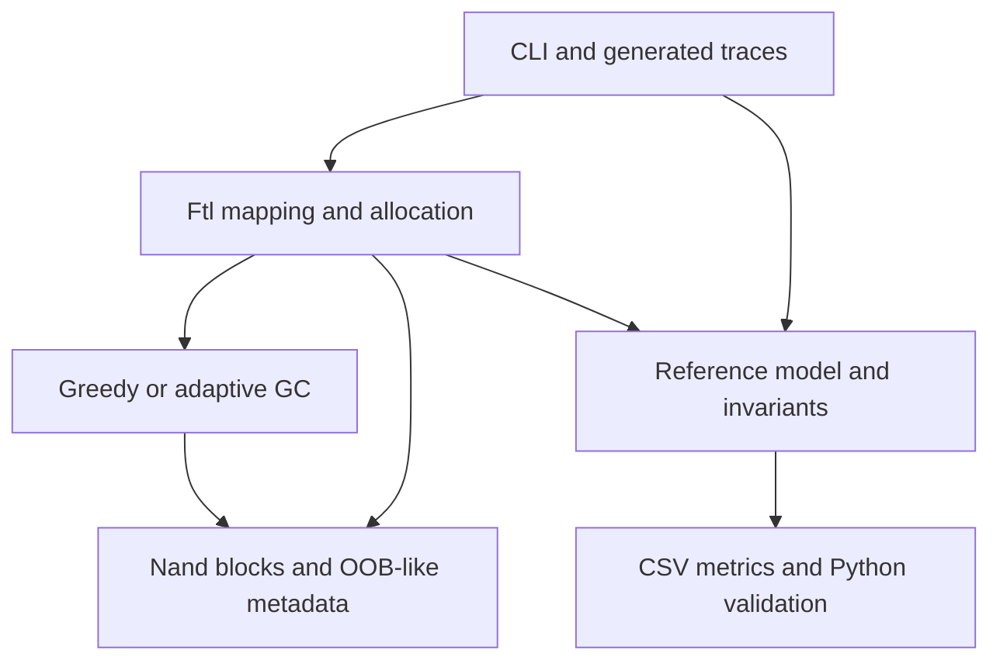

# FlashCore SSD

**NAND flash management and firmware validation simulator | C++17 + Python**

An educational final-year project for understanding page-level FTL, garbage
collection, wear-aware allocation and failure-path testing. This is a CPU-based
simulator, not real SSD firmware, a NAND controller, or a performance predictor.

**Verified on Linux:** 38/38 CTest entries; 80 held-out policy runs; 72 geometry
compatibility runs; zero correctness violations in successful validation runs.
The fault campaign preserves values across 18,000 operations including 946
expected failed writes. The deliberate TRIM bug is detected, not shipped enabled.

## Problem and scope

NAND updates leave obsolete pages. Reclaiming blocks safely requires moving valid
pages, protecting mappings, reserving space, and handling failures without losing
logical values. FlashCore makes these decisions visible and testable. Payloads
are uint64_t values; no frontend, cloud, drivers, ML, or external C++ dependencies.

## JD alignment

| JD responsibility | Implementation and evidence |
|---|---|
| C/C++ SSD/embedded storage logic | C++17 Nand/Ftl, checked geometry, out-of-place mapping |
| GC, wear leveling, error handling | Exactly two GC policies, two allocation modes, explicit statuses, deterministic faults |
| Unit tests | 38 CTest entries, including randomized oracle and fault campaign |
| Issue/root cause analysis | Compile-time TRIM defect, two-operation reproducer, failing gate and fixed regression |
| Compatibility/performance validation | 72 geometry runs; 80 held-out policy runs; simulator runtime and WAF |
| Python automation | stdlib validator, CSV contract checks, comparison tables, reproduction runner |
| Documented test/debug results | Raw logs, CSVs, reproduction.json, DEBUG_LOG and this report |

## Architecture and features



FREE/VALID/INVALID lifecycle; page-level READ/WRITE/TRIM; copy-before-invalidate;
bounded collection with reserve and active-block exclusion; dynamic wear-aware
free-block selection; pre-operation program/erase faults; controlled bad-block
retirement; metadata-scan mapping reconstruction; reference-model correctness gate.
Detailed semantics, complexity and failure guarantees are in ARCHITECTURE.md.

## Build and run

Requires a C++17 compiler, CMake >=3.16 and Python 3. Python uses standard library
only. Tested GCC 13.3.0 and Python 3.12.14. No package installation is needed for
the project itself. CMake must be on PATH.

### Linux

```sh
cmake -S . -B build -DCMAKE_BUILD_TYPE=Release
cmake --build build --parallel 2
ctest --test-dir build --output-on-failure
./build/flashcore demo
./build/flashcore inspect
./build/flashcore test-workload --input workloads/example.csv
./build/flashcore benchmark --policy adaptive --alloc wear --seed 101 --workload hotcold --output metrics.csv
python3 python/run_validation.py --exe build/flashcore --mode evaluation
python3 python/reproduce.py --build build-new
```

### Windows 11 / PowerShell (verified with MSVC 19.44)

**Windows 11 verification — 26 October 2026**

- Compiler: MSVC 19.44 (Visual Studio 2022)
- CMake Release build: PASSED
- CTest: 38/38 passed (100%)
- Total CTest execution time: 4.87 seconds
- Python validation: 80 held-out runs passed
- Compatibility validation: 72 runs passed
- Invalid geometries: 4 expected rejections
- Python version: 3.12.10

These results were verified locally on Windows 11.

Install Visual Studio Build Tools with Desktop development with C++, CMake and
Python 3. Open Developer PowerShell for VS and change into the extracted folder.

```powershell
cmake -S . -B build
cmake --build build --config Release
ctest --test-dir build -C Release --output-on-failure
.\build\Release\flashcore.exe demo
.\build\Release\flashcore.exe inspect
.\build\Release\flashcore.exe test-workload --input workloads/example.csv
.\build\Release\flashcore.exe benchmark --policy adaptive --alloc wear --seed 101 --workload hotcold --output metrics.csv
python python/run_validation.py --exe build/Release/flashcore.exe --mode evaluation
python python/reproduce.py --build build-new
```

With Ninja/single-config generators, executable is `build/flashcore.exe` instead.
Build configuration must match CTest's `-C` argument for Visual Studio.

### Sanitizers

```sh
cmake -S . -B build-san -DCMAKE_BUILD_TYPE=Debug -DFLASHCORE_SANITIZE=ON
cmake --build build-san --parallel 2
ctest --test-dir build-san --output-on-failure
```

GCC/Clang enables ASan+UBSan; MSVC enables ASan only. This host required
`ASAN_OPTIONS=detect_leaks=0 UBSAN_OPTIONS=halt_on_error=1 ctest --test-dir build-san --output-on-failure`
because LeakSanitizer cannot inspect /proc. Only disable leak checking when your
environment requires it; leak validation is unverified here.

## CLI contract

Human-readable summaries go to stderr; machine-readable header+row CSV goes to
stdout and optionally `--output`. Exit 0 means success, 1 means operation or
correctness failure, 2 means invalid CLI/input/configuration. Each invocation
creates a fresh in-memory device; inspect reports a fresh device, while demo
reports its post-demo blocks. There is no persistent image across commands.

CSV workload format is exactly `op,lpn,value`; W, R and T are supported. Values
are unsigned integers; R/T still require a value column (ignored). No quoted
fields, comments or blank rows. See workloads/example.csv. Logical capacity and
physical geometry are configurable with --logical, --blocks and --pages.
Benchmark workload names: sequential, uniform, hotcold, mixed. All numerical
arguments are validated. --operations defaults to 5000. --weight, --threshold,
--decay and --watermark support development experiments; do not retune using the
held-out seeds. `--alloc basic|wear` controls erased-block allocation.

## Actual demo output

The following summary is copied from the clean release run:

```text
FlashCore educational simulator: 3 successful writes; WAF=1; correctness violations=0; operation errors=0
```

Full CSV is in results/demo.csv. It includes per-block erase counts, free space,
physical programs, migrations, cycles, failed writes, WAF and correctness count.
Simulator throughput is software execution speed, never SSD IOPS.

## Policy findings

| Allocation | Workload | Greedy mean WAF | Adaptive mean WAF | Adaptive change | Wear stddev criterion |
|---|---|---:|---:|---:|---|
| basic | sequential | 1.00000 | 1.00000 | +0.00% | Pass |
| basic | uniform | 1.76516 | 1.79040 | +1.43% | Pass |
| basic | hotcold | 2.29688 | 2.18916 | -4.69% | Pass |
| basic | mixed | 1.31680 | 1.32230 | +0.42% | Pass |
| wear | sequential | 1.00000 | 1.00000 | +0.00% | Pass |
| wear | uniform | 1.77080 | 1.78632 | +0.88% | Pass |
| wear | hotcold | 2.29912 | 2.19500 | -4.53% | Pass |
| wear | mixed | 1.31486 | 1.31596 | +0.08% | Pass |

Adaptive helped hot/cold but slightly worsened uniform and mixed WAF. No universal
performance or hardware endurance improvement is claimed. Full means/medians,
frozen development controls, citations and limits: docs/RESEARCH_COMPARISON.md.

## Files

- include/flashcore.hpp: data types, Nand and Ftl interfaces.
- src/flashcore.cpp: NAND, allocation, GC, mapping and invariant implementations.
- src/main.cpp: CLI parser, trace generation, oracle and CSV output.
- tests/: named unit cases and mixed fault campaign.
- python/: validation, comparisons, CLI contract tests and evidence reproduction.
- workloads/: example trace and minimal deliberate-bug reproducer.
- results/: actual CSVs, frozen controls, raw build/test/error evidence.
- docs/: architecture, test plan, RCA, research, evidence, interview and resume guides.
- .github/workflows/ci.yml: Linux/Windows workflow, not executed on GitHub.

## Limitations and honest claims

Windows/MSVC Release build, CTest, and Python validation were verified locally on Windows 11. Windows sanitizer execution and hosted GitHub Actions remain unverified. LeakSanitizer unavailable on this host.
No real hardware, ECC, bit faults, NAND timings, NVMe/PCIe, static wear leveling,
wear-out limits, persistent device state, crash consistency or sudden unreadable
bad-block recovery. Planned retirement can exhaust reserve space. A partial
migration preserves data but may reduce future progress. Geometry is bounded to
one million pages. Warm-up is fill-only, not steady state. Research results use
five seeds and small synthetic devices. No savings, customers or ROI measured.

Core source and tests are intentionally concise (below the requested 2,000-line
target); no filler or framework was added to reach a line count. Source, tests,
automation, documentation and actual results are complete within the stated scope.
