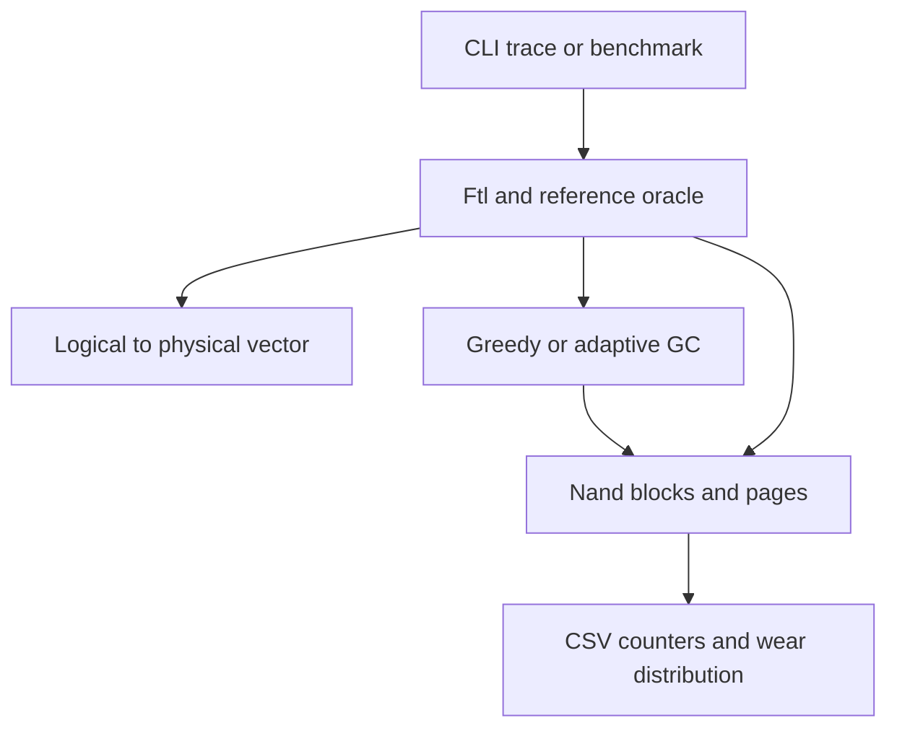

# Architecture and failure guarantees

## Data path

`Geometry` contains physical blocks, pages per block, and logical page capacity.
`Nand` owns `vector<Block>`; each `Block` owns `vector<Page>`. `Ftl` owns the NAND,
a mapping vector, a heat vector, active block index, and a monotonic sequence.
No raw owning pointers, inheritance, threads, hardware registers, or persistence.
The public NAND state supports inspection and deliberate test setup; applications
must not mutate it behind the FTL. Invariants apply to FTL-managed operations.

## NAND rules

FREE -> VALID only after a successful program; VALID -> INVALID on replacement
or TRIM; INVALID/FREE -> FREE after block erase. Erase refuses a block containing
VALID pages (`busy`) rather than silently losing live data. This is a simulator
safety guard, not a physical NAND limitation. Retirement excludes a block from
future allocation. Page payload is one uint64_t; OOB-like metadata consists of
logical address and sequence number. No bit-level ECC or timing is simulated.

Geometry arithmetic uses uint64_t before multiplying. Zero, fewer than three
blocks, sentinel collision, physical capacity above 1,000,000 pages, or OP <= one
block is rejected. The extra OP page is necessary for out-of-place progress.
This supports an initial geometry, not an availability guarantee after retirement.

## Write and allocation

1. Count host attempt; validate logical address and sequence capacity.
2. Reuse a free page in the active block.
3. Otherwise reuse partial migration blocks, deterministically by block index.
4. When <=2 completely free blocks remain and an eligible victim exists, collect.
5. Otherwise open a free block only if more than one free block remains.
6. Program replacement, then invalidate old page, update map, increment heat.

Opening a fully free block uses lowest index for `basic` or lowest erase count
then lowest index for `wear`. Partial blocks are reused by index in both modes.
The allocation loop is bounded by blocks+1 attempts and never calls itself.
The active block is never a GC victim, including when full; it changes when
allocation chooses a different block. Some space is deliberately unavailable
under restrictive reserve/active-block rules. `out_of_space` is a safe result.

## Collection

Eligible means not active, not bad, and at least one INVALID page. Greedy chooses
most invalid pages with lowest index on ties. Adaptive scores
`invalid/P - w * hot_valid/P`; a page is hot when its logical counter >= T.
Successful host writes increment heat; every N successful host writes halve all
counters using integer division. Failed attempts do not teach heat. When free
blocks <= watermark, effective w=0. Defaults are frozen in
`results/frozen_parameters.json`: w=0.5, T=3, N=256, watermark=1.

Collection uses one fully free destination block, sufficient for all remaining
valid victim pages. After each successful copy, update map, invalidate source,
and count migration. Only after all valid pages have moved may erase run.
A zero-valid victim can be erased without allocating a destination. The destination
remains partially filled for later writes. GC copies retain sequence numbers;
host overwrites alone allocate new sequence numbers.

## Fault model

| Event | Timing/model | Guarantee | Boundary |
|---|---|---|---|
| Program fault | One-shot, before target modification; countdown counts eligible programs | Target stays FREE; old value remains, unless earlier successful GC copies relocated it | No torn page, bit flips, or post-operation failure |
| Erase fault | One-shot, before erase; triggered after migration | Victim contents and erase count unchanged; maps already point to successful copies | No automatic bad-block retirement; retry possible |
| Partial GC program failure | After zero or more separately committed copies | Every live logical value still has exactly one VALID physical page | Partial destination retained; consumes reserve capacity; no rollback or guaranteed later progress |
| Retirement | Explicit planned evacuation then mark bad | Retires only after all valid pages copied; failures leave source usable | Does not model sudden unreadable blocks |
| Invalid address | Before mutation | Returns invalid_address | Logical read validation counts as invalid operation |
| Out of space | Reserve/eligibility guard or bounded-loop exhaustion | Host value unchanged; previous successful GC work retained | Remaining physical free space may exist but be unavailable to allocator |

Fault countdown -1 disables, 0 fails next eligible operation, k permits k eligible
operations then fails once. Invalid/busy/bad operations do not consume countdown.
No automatic retries hide failures. The fault campaign validates values and map
invariants after every operation, including partial GC and retirement failures.

## Reconstruction and invariants

`rebuild_mapping_from_metadata()` returns a reconstructed vector, scanning VALID
pages and taking the highest sequence for each logical address (first physical
address on equal sequence). It does not restore a full device or mutate the live
map. Tests compare it to the live map. TRIM is represented by invalidation, not a
persistent tombstone. This is not crash consistency, restart recovery, or atomic
persistent metadata. A dedicated test injects duplicate metadata to check
highest-sequence selection and verifies that invariants reject the duplicate.

The checker verifies unique physical ownership, map to VALID page with matching
logical ID, no mapping into bad blocks, and no VALID page without a map.
`compare()` additionally reads every logical page against `unordered_map` oracle.
Only successful writes modify oracle; successful TRIM removes an entry.

## Accounting and complexity

WAF = successful physical programs / successful host writes. A migration that
succeeds before a later failure still counts. Failed program operations count no
program; TRIM performs no program and never enters the denominator. WAF is zero
when no host writes succeed. Erases count only successful erases. Invalid ops
counts rejected address and program-on-nonfree requests, not every possible
error class. `failed_writes` counts failed host writes, not standalone GC calls.

`erase_counts` is an index-ordered pipe-separated vector in CSV. Min/max/stddev
are cumulative wear across all blocks, including any bad blocks. Benchmark
warm-up has no erases for the chosen geometry; host/program counters reset after
fill. Wall time covers trace execution, excluding generation, warm-up, final
validation and file output. Simulator throughput is trace operations/second.

Read and map lookup are O(1). Scans for free space, victim selection, reconstruction,
and invariants are O(B*P + L) or smaller. GC migration is O(P^2) here because slot
lookup scans its destination per copy; small P keeps this explicit and teachable.
Storage is O(B*P + L). It is not a scalable SSD implementation.
